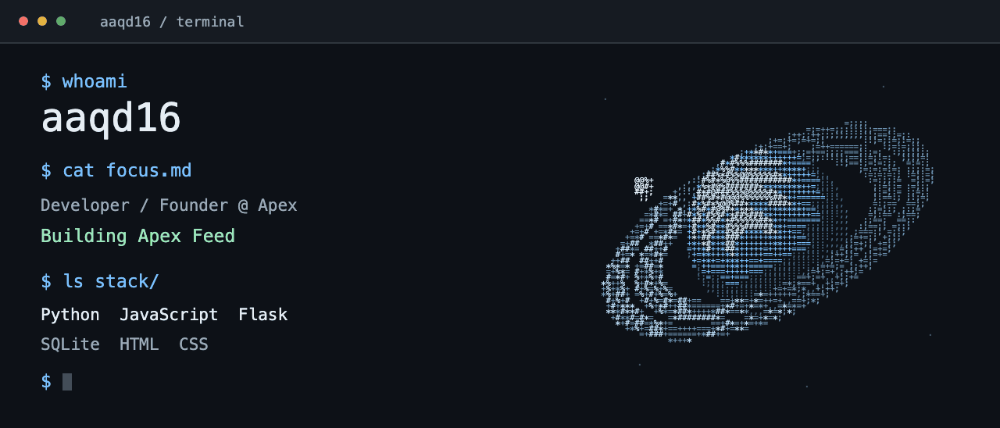
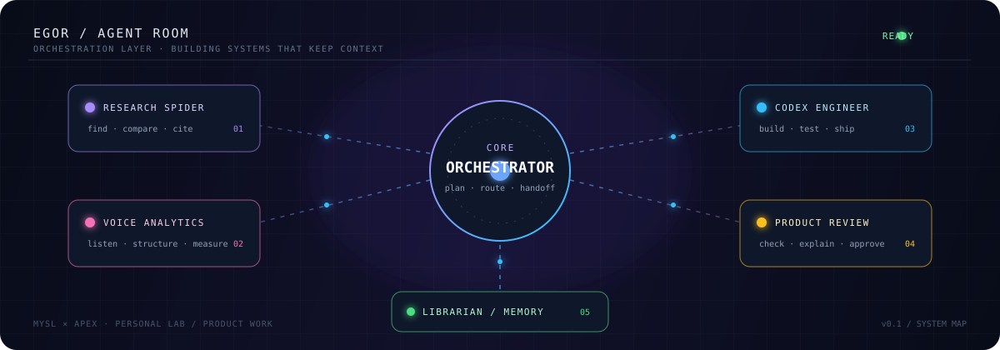

<div align="center">

<picture>
  <source media="(prefers-reduced-motion: reduce) and (max-width: 600px)" srcset="assets/terminal-mobile-still.png">
  <source media="(prefers-reduced-motion: reduce)" srcset="assets/terminal-still.png">
  <source media="(max-width: 600px)" srcset="assets/terminal-mobile.gif">
  
</picture>

<br>

# Egor Kolyshev

### Developer · Product builder · AI systems

<p>
  Building products at <b>Mysl</b> and developing <b>Apex</b> —<br>
  tools that turn real workflows into simpler systems.
</p>

<p>
  <a href="https://apex-ai.com.ru/"></a>
  <a href="https://t.me/aaqd9"></a>
  <a href="https://www.instagram.com/aaqd.9/"></a>
</p>

</div>

<p align="center">
  
</p>

---

## Сейчас

<table>
  <tr>
    <td width="50%" valign="top">
      <b>Mysl</b><br>
      Product work around voice analytics, interactive screens, AI avatars and agent systems.
    </td>
    <td width="50%" valign="top">
      <b>Apex</b><br>
      Building Apex Feed — automation for fitness clubs, service teams and everyday operations.
    </td>
  </tr>
</table>

I like products that survive contact with real work: clear interfaces, reliable integrations, useful automation and systems that keep their context.

## What I build

```text
AI systems          agents, orchestration, memory and practical automation
Voice analytics     transcription pipelines, speaker context and quality checks
Product engineering  APIs, dashboards, integrations and tools for teams
Workflow automation  turning repetitive operational work into reliable flows
```

## Selected work

- **Apex Feed** — my current product for fitness-club operations; the production source is private. [apex-ai.com.ru](https://apex-ai.com.ru/)
- **AI avatar / voice analytics** — experimenting with fast, useful interfaces for spoken interaction.
- **Inter-screen** — exploring interactive screens, product analytics and 1C integrations at Mysl.
- **Agent systems** — designing an orchestrator that can research, build, test and hand work off for review.
- **infodigger-bot** — a public Python repository for collecting and organizing information. [View repository](https://github.com/aaqd16/infodigger-bot)

## Stack

<p>
  <code>Python</code>
  <code>Flask</code>
  <code>JavaScript</code>
  <code>TypeScript</code>
  <code>SQLite</code>
  <code>PostgreSQL</code>
  <code>Telegram Bots</code>
  <code>REST APIs</code>
  <code>AI workflows</code>
  <code>Git</code>
</p>

I started with competitive-programming foundations in C++, Python and C#, and now focus on building complete products: from the first interface and data model to deployment, testing and handoff.

## How I work

```text
understand the workflow → build the smallest useful system
measure what matters   → keep the context and the decisions
review the result      → ship something another person can run
```

<div align="center">

### Keep building things that make the next step easier.

<sub><a href="art/terminal.mjs">The terminal animation is rendered from code.</a></sub>

</div>
